# Домашнє завдання 2: Nginx в Amazon ECS Fargate

Розгорнуто дві задачі з Nginx у Fargate, завантажено образ до приватного Amazon ECR і налаштовано доступ через Application Load Balancer. Усі ресурси створено у регіоні **sa-east-1 (São Paulo)**.

Шлях запиту після налаштування: браузер → ALB (HTTP:80) → Target Group → контейнер Nginx (порт 80).

## 1. ECS-кластер

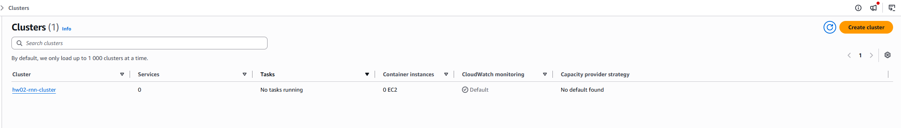

Створено кластер `hw02-rnn-cluster`, у якому далі запускатиметься ECS-сервіс. На цьому етапі в кластері ще немає сервісів і задач; EC2-інстанси для запуску контейнерів не створювалися.

## 2. Приватний репозиторій Amazon ECR

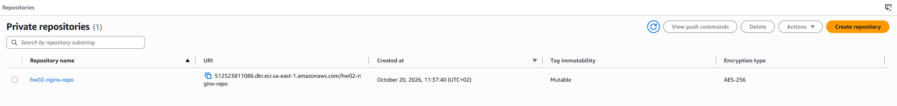

Створено репозиторій `hw02-nginx-repo` для зберігання образу Nginx, який використовуватиме ECS. На кадрі видно URI репозиторію, змінювані теги (Mutable) та шифрування AES-256; до назви `nginx-repo` з умови додано префікс `hw02-`.

## 3. Завантаження образу до ECR

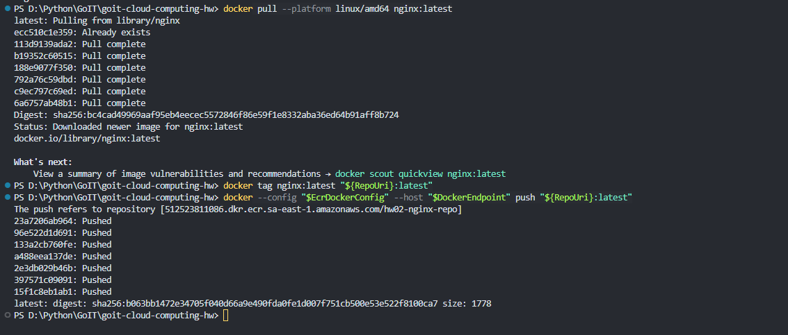

Завантажено `nginx:latest` для платформи `linux/amd64`, присвоєно тег із URI створеного ECR-репозиторію та відправлено образ командою `docker push`. Рядки `Pushed` та підсумковий digest підтверджують завершення завантаження — тепер Fargate може отримати образ зі створеного репозиторію.

Під час `docker login` виникла помилка сховища облікових даних Windows (`The stub received bad data`). Для входу та завантаження використано окремий тимчасовий конфіг Docker через `--config`, а після завершення виконано `docker logout` для цього конфігу.

## 4. Task Definition

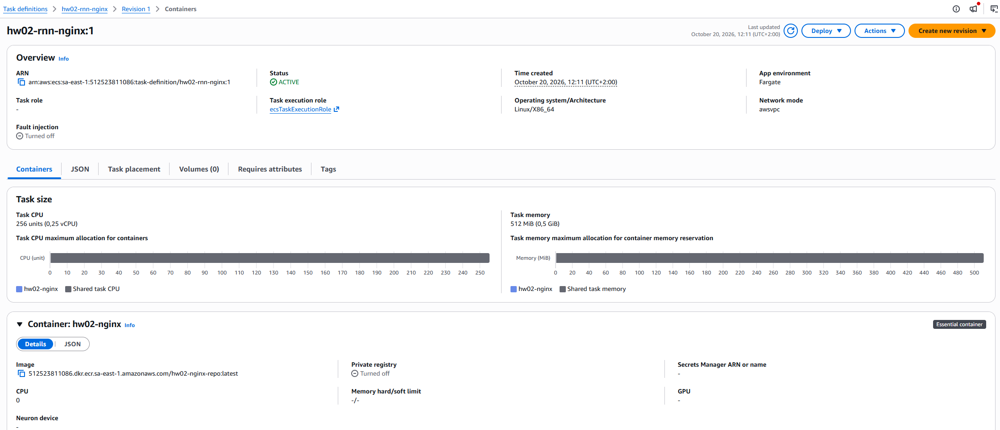

Зареєстровано `hw02-rnn-nginx:1` для Fargate з Linux/X86_64, мережею `awsvpc` та образом із ECR. Виділено мінімальні ресурси — **0.25 vCPU і 512 MiB пам’яті**; роль `ecsTaskExecutionRole` потрібна ECS для отримання образу та роботи з логами.

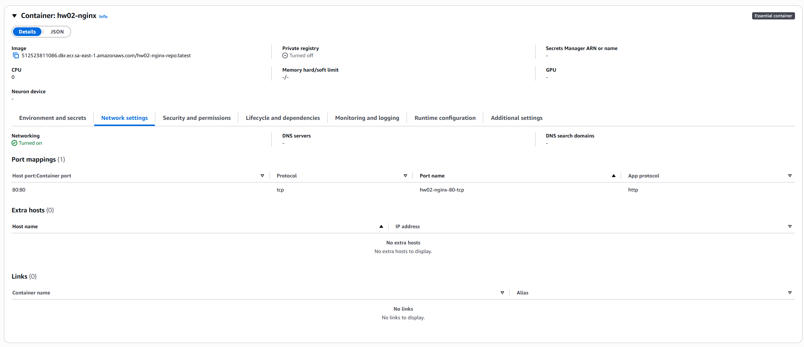

Для контейнера `hw02-nginx` налаштовано зіставлення портів `80:80`, транспортний протокол TCP та протокол застосунку HTTP. Саме на цей порт балансувальник передаватиме запити до Nginx.

## 5. ECS-сервіс із двома задачами

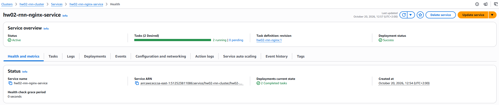

Створено сервіс `hw02-rnn-nginx-service` на основі `hw02-rnn-nginx:1` із бажаною кількістю задач **2**. На кадрі видно `2 running`, `0 pending` і статус розгортання `Success`: сервіс запустив обидві копії контейнера.

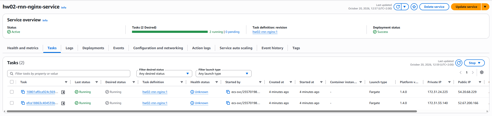

На вкладці Tasks підтверджено, що обидві задачі мають стан `Running` і тип запуску **Fargate**. Їм призначено окремі приватні та публічні IP-адреси; у цій мережевій схемі публічні адреси потрібні для отримання образу з ECR без NAT Gateway.

## 6. Application Load Balancer

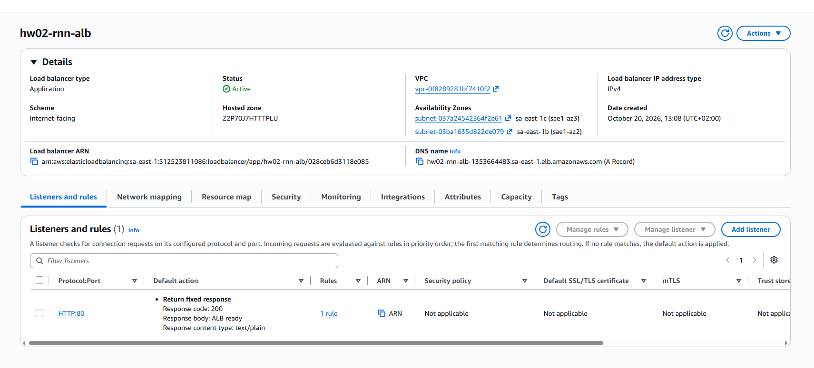

Створено публічний ALB `hw02-rnn-alb` у тій самій VPC, що й ECS-сервіс, у зонах `sa-east-1b` та `sa-east-1c`. На кадрі він уже має статус **Active**; listener HTTP:80 поки повертає тимчасовий текст `ALB ready`, який на наступному кроці замінено пересиланням до Target Group.

Для ALB створено Security Group `hw02-rnn-alb-sg` із вхідним HTTP на порт 80. У групі ECS-сервісу додано правило HTTP:80 з джерелом `hw02-rnn-alb-sg`, щоб балансувальник міг звертатися до контейнерів.

## 7. Target Group і підключення сервісу

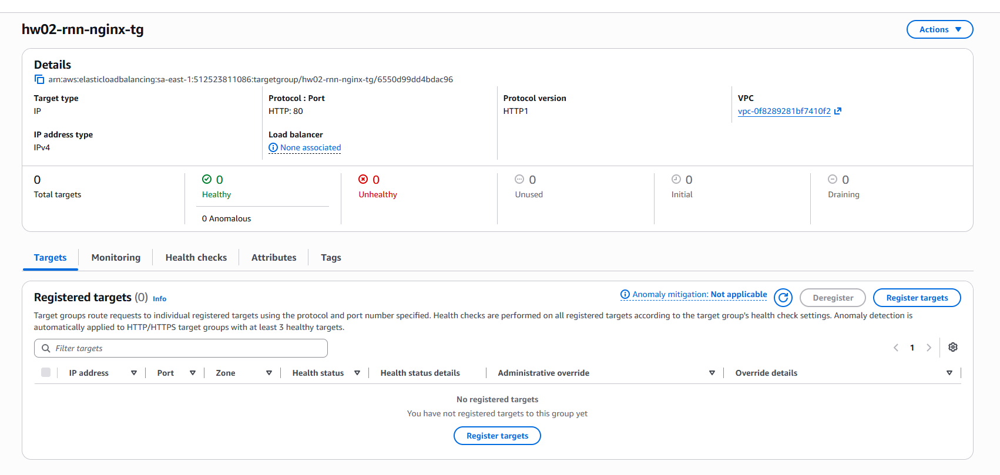

Створено `hw02-rnn-nginx-tg` з типом цілей **IP** та протоколом HTTP на порту 80. Це проміжний стан: балансувальник ще не приєднаний і цілей немає, оскільки їхні адреси має зареєструвати ECS після підключення сервісу.

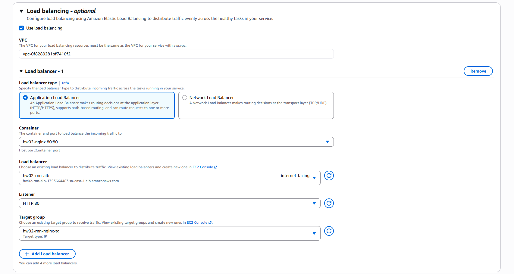

У формі оновлення сервісу вибрано ALB `hw02-rnn-alb`, listener HTTP:80, контейнер `hw02-nginx` із портом 80 та групу `hw02-rnn-nginx-tg`. Ці параметри зв’язують сервіс із балансувальником; дію listener також змінено із фіксованої відповіді на пересилання до цієї групи.

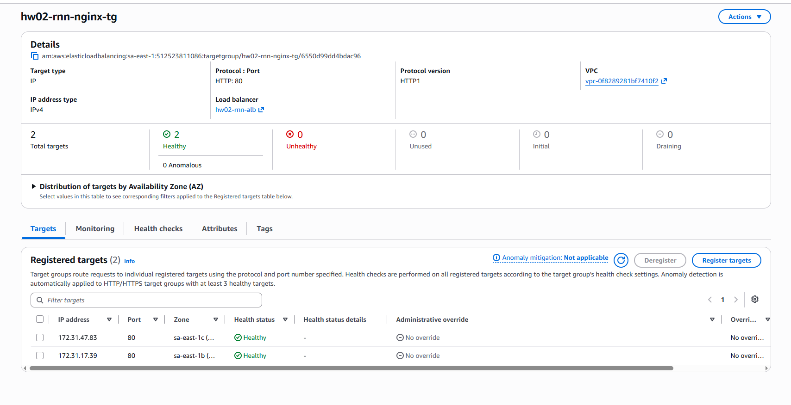

Після оновлення сервісу засобами ECS зареєстровано дві IP-адреси задач у різних зонах доступності. Обидві цілі на порту 80 мають статус **Healthy**, а в полі Load balancer видно `hw02-rnn-alb` — перевірки працездатності проходять і група підключена до ALB.

## 8. Перевірка доступу через ALB

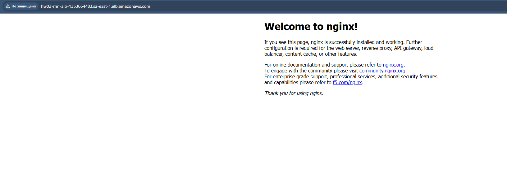

Відкрито DNS-адресу ALB у браузері й отримано сторінку **Welcome to nginx!**. Це підтверджує проходження HTTP-запиту через балансувальник до контейнера; позначка «Не захищено» пов’язана з використанням HTTP без налаштованого HTTPS.

## Очищення ресурсів

Ресурси можна видалити вручну через AWS Management Console. Перед початком потрібно перевірити акаунт `512523811086` і вибрати регіон **sa-east-1 (São Paulo)**. Видалення виконується в такому порядку:

1. **Зупинка задач і видалення ECS-сервісу.** У **ECS → Clusters → hw02-rnn-cluster → Services → hw02-rnn-nginx-service** відкрити **Update service**, установити **Desired tasks: 0** і зберегти зміни. Дочекатися **Running tasks: 0**, після чого натиснути **Delete service** та підтвердити видалення.

2. **Видалення ALB.** У **EC2 → Load Balancers** вибрати `hw02-rnn-alb` і виконати **Actions → Delete load balancer**. Дочекатися зникнення балансувальника зі списку; його listener HTTP:80 видаляється разом із ним.

3. **Видалення Target Group.** У **EC2 → Target Groups** вибрати `hw02-rnn-nginx-tg` і натиснути **Actions → Delete**. Якщо з’являється помилка `ResourceInUse`, перевірити, чи видалено ALB, зачекати звільнення зв’язків із listener та повторити спробу.

4. **Видалення доданого правила з групи `default`.** У **EC2 → Security Groups** відкрити `sg-06413027012796964` (**default**) → **Inbound rules → Edit inbound rules**. Видалити лише правило **HTTP, TCP:80**, джерелом якого є `sg-016e185d716e266ab` (`hw02-rnn-alb-sg`), і натиснути **Save rules**. Початкове правило групи залишити.

5. **Видалення групи безпеки ALB.** У **EC2 → Security Groups** вибрати `hw02-rnn-alb-sg` (`sg-016e185d716e266ab`) та виконати **Actions → Delete security groups**. Якщо група ще використовується мережевим інтерфейсом ALB, зачекати кілька хвилин і повторити видалення.

6. **Видалення ECS-кластера.** У **ECS → Clusters → hw02-rnn-cluster** переконатися, що немає сервісів і працюючих задач, після чого натиснути **Delete cluster** та підтвердити дію.

7. **Видалення образів і ECR-репозиторію.** У **ECR → Private repositories → hw02-nginx-repo → Images** вибрати всі образи та натиснути **Delete**. Повернутися до списку репозиторіїв, вибрати `hw02-nginx-repo` й видалити його.

8. **Видалення Task Definition.** У **ECS → Task definitions → hw02-rnn-nginx** вибрати активні ревізії та виконати **Actions → Deregister**. Після переходу в стан **INACTIVE** вибрати ці ревізії й виконати **Actions → Delete**. Остаточне видалення може завершитися із затримкою.

9. **Видалення логів.** У **CloudWatch → Logs → Log groups** знайти групу, указану в налаштуваннях логування контейнера, наприклад `/ecs/hw02-rnn-nginx`. Якщо вона належить лише цьому завданню, вибрати її та виконати **Actions → Delete log group(s)**.

10. **Видалення ролі виконання за потреби.** Якщо `ecsTaskExecutionRole` створено лише для цього завдання та вона не використовується іншими ECS-задачами, відкрити **IAM → Roles → ecsTaskExecutionRole → Delete** і підтвердити видалення. Спільну роль можна залишити для наступних завдань.

Спільні VPC, підмережі, Internet Gateway, групу `default` та роль `AWSServiceRoleForECS` потрібно залишити. Публічні IP-адреси та мережеві інтерфейси задач і ALB звільняються автоматично після видалення відповідних ресурсів. Сторінка Nginx за адресою ALB стане недоступною; локальні скриншоти залишаться в репозиторії.

**Варіанти швидшого очищення через консоль:**

- **ECS-сервіс можна видалити без окремого оновлення Desired tasks.** У вікні **Delete service** вибрати **Force delete service** та підтвердити видалення. Це скорочує кількість дій, але зупинка задач усе одно потребує часу; перед видаленням кластера потрібно перевірити їхній стан. [Документація AWS](https://docs.aws.amazon.com/AmazonECS/latest/developerguide/delete-service-v2.html)

- **ECR-репозиторій можна видалити одразу разом з образами.** У **ECR → Private repositories** вибрати `hw02-nginx-repo` → **Delete** та підтвердити видалення репозиторію і його вмісту. Попередньо видаляти образи по одному не потрібно. [Документація AWS](https://docs.aws.amazon.com/AmazonECR/latest/userguide/repository-delete.html)

- **Незалежні дії можна виконувати в окремих вкладках.** Після запуску видалення ECS-сервісу можна одразу запустити видалення ALB. Поки звільняються його мережеві інтерфейси, можна прибрати додане HTTP-правило з групи `default`; після зупинки задач — видалити ECR-репозиторій. Target Group потрібно видаляти після звільнення зв’язку з listener, групу безпеки ALB — після звільнення мережевих інтерфейсів, а кластер — після видалення сервісу та зупинки задач.

- **Ревізії Task Definition можна обробляти групою.** Позначити всі потрібні ревізії та виконати **Deregister**, а потім **Delete** для неактивних ревізій, замість повторення цих дій для кожної окремо. Групу логів варто видаляти після зупинки задач, щоб нові записи не створювалися під час очищення.
