# Домашнє завдання 3: PostgreSQL в Amazon RDS

Створено PostgreSQL-інстанс в Amazon RDS у регіоні **sa-east-1 (São Paulo)**. Виконано підключення з комп’ютера через `psql` у Docker-контейнері, створено таблицю `users`, додано тестовий запис і перевірено збереження даних. Додатково перевірено доступ через PostgreSQL-розширення VS Code.

Шлях підключення: клієнт на комп’ютері → Endpoint RDS → PostgreSQL, TCP:5432. Доступ обмежено поточною IP-адресою комп’ютера через Security Group; саму адресу в звіті не наведено.

## 1. Створення RDS-інстансу

Порядок виконання:

1. Увійти в AWS Console, вибрати **sa-east-1** і відкрити **RDS → Databases → Create database**.
2. Вибрати **PostgreSQL → Full configuration** (Standard create в умові), шаблон **Free tier** та **Single-AZ DB instance deployment**.
3. Указати **DB instance identifier: hw03-rnn-db**, **Master username: postgres**, вибрати **Self managed** і задати пароль бази.
4. У **Instance configuration** вибрати **Burstable classes → db.t3.micro**. Для сховища встановити **General Purpose SSD (gp2), 20 GiB** і вимкнути **Storage autoscaling**.
5. У **Connectivity** залишити **Don’t connect to an EC2 compute resource**, вибрати default VPC, **Public access: Yes** та створення групи **hw03-rnn-rds-sg**. RDS Proxy не вмикати.
6. У **Additional configuration → Backup** увімкнути автоматичні резервні копії та встановити **Backup retention period: 7 days**. Initial database name залишити порожнім, Deletion protection вимкнути.
7. Перевірити параметри й оцінку вартості, натиснути **Create database** та дочекатися статусу **Available** у списку Databases.

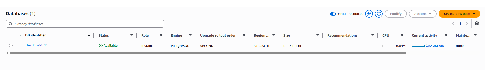

Створено інстанс `hw03-rnn-db` із PostgreSQL та класом `db.t3.micro`. Статус **Available** підтверджує завершення створення й готовність бази до підключення.

Для перевірки ресурсів відкрити **Databases → hw03-rnn-db → Configuration**. У блоках **Instance class** та **Primary storage** перевірити клас, обсяг пам’яті, тип і розмір диска.

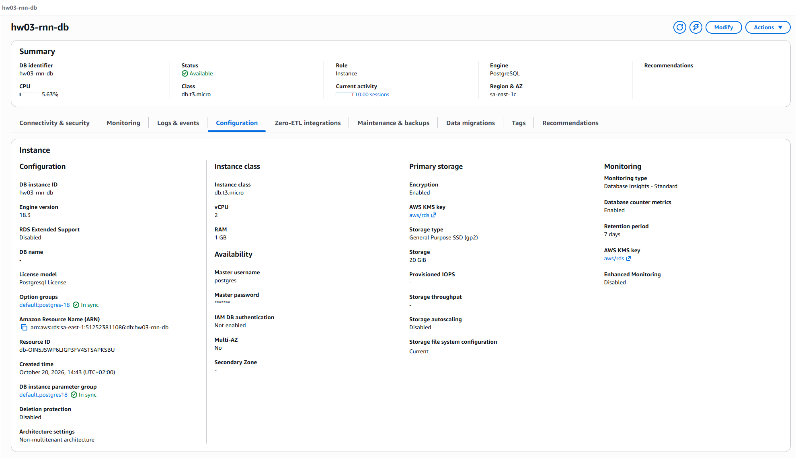

На вкладці Configuration перевірено PostgreSQL **18.3**, клас **db.t3.micro**, **1 GB RAM** і сховище **General Purpose SSD (gp2), 20 GiB**. Використано Single-AZ та користувача `postgres`; автоподмасштабування диска й захист від видалення вимкнено для навчального завдання.

У консолі для `db.t3.micro` зазначено **2 vCPU**, хоча в описі завдання наведено 1 vCPU. Вибрано саме клас `db.t3.micro`, який вимагається критеріями прийняття.

За умовою автоматичні резервні копії мають зберігатися **7 днів**. Цей параметр перевіряється окремо на вкладці **Maintenance & backups**: значення **7 days** у блоці Monitoring на скриншоті стосується метрик і не підтверджує строк зберігання резервних копій.

## 2. Endpoint і параметри підключення

Відкрити **RDS → Databases → hw03-rnn-db → Connectivity & security**. У блоці **Connect using** вибрати **Code snippets** та переглянути Endpoint, посилання на сертифікат і приклад команди `psql`.

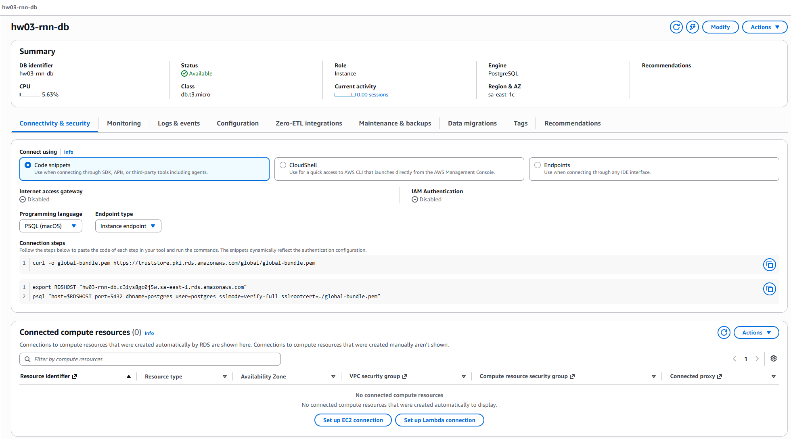

У блоці Code snippets отримано Endpoint та приклад підключення з перевіркою SSL-сертифіката. Показаний приклад для macOS адаптовано до PowerShell і Docker, оскільки робота виконувалася у Windows.

Перемкнути **Connect using → Endpoints** і розгорнути **Additional configurations**. Скопіювати Endpoint та перевірити **Port: 5432**, **Publicly accessible: Yes**, VPC і приєднану Security Group.

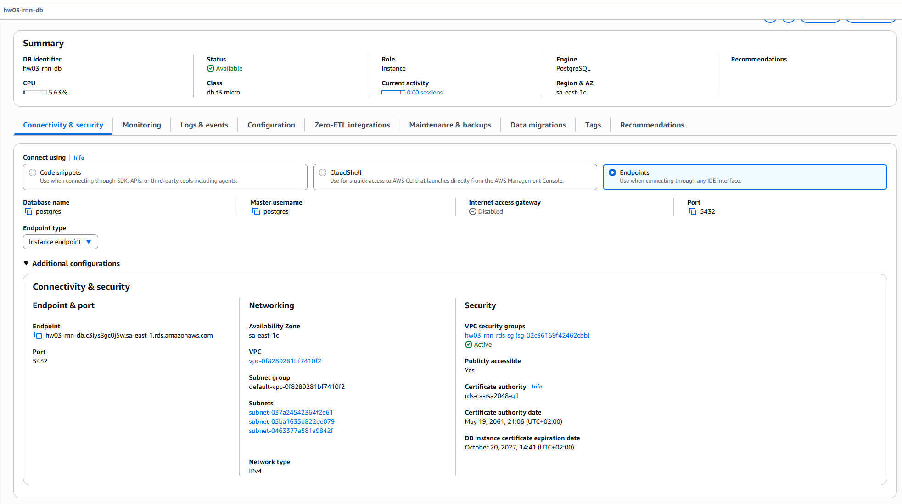

Перевірено порт **5432**, базу та користувача **postgres**, default VPC і параметр **Publicly accessible: Yes**. До інстансу приєднано Security Group `hw03-rnn-rds-sg`, яка дозволяє підключення з комп’ютера.

Endpoint: `hw03-rnn-db.c3iys8gc0j5w.sa-east-1.rds.amazonaws.com`.

## 3. Підключення через psql

Відкрити **hw03-rnn-rds-sg → Inbound rules** і перевірити правило **PostgreSQL / TCP:5432 / Source: My IP**. Якщо правила немає або IP змінилася, оновити його через **Edit inbound rules**. Скриншот правила не додається, щоб не публікувати особисту IP-адресу.

Запустити **Docker Desktop** у режимі Linux containers і відкрити PowerShell у папці проєкту. Завантажити сертифікат AWS RDS та запустити клієнт `psql` такими командами:

```powershell
Invoke-WebRequest -Uri "https://truststore.pki.rds.amazonaws.com/global/global-bundle.pem" -OutFile ".\global-bundle.pem"

$RdsEndpoint = "hw03-rnn-db.c3iys8gc0j5w.sa-east-1.rds.amazonaws.com"

docker run --rm -it --mount "type=bind,source=$($PWD.Path)\global-bundle.pem,target=/tmp/global-bundle.pem,readonly" postgres:18 psql "host=$RdsEndpoint port=5432 dbname=postgres user=postgres sslmode=verify-full sslrootcert=/tmp/global-bundle.pem"
```

У відповідь на **Password for user postgres** ввести пароль RDS-бази та натиснути Enter. Символи пароля не відображаються. Дочекатися повідомлення про SSL-з’єднання та запрошення `postgres=>`; залишити сеанс відкритим для SQL-команд наступних кроків.

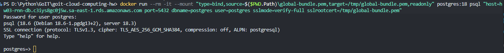

Запущено клієнт `psql` з образу `postgres:18`, без установлення PostgreSQL у Windows. На кадрі видно успішне підключення до сервера, SSL-з’єднання **TLSv1.3** і запрошення `postgres=>`; використано `sslmode=verify-full` із сертифікатом AWS RDS.

Для додаткового підключення відкрити PostgreSQL-розширення VS Code → **New Connection**. Указати Endpoint як **Server name**, **Authentication type: Password**, користувача й базу **postgres**, пароль RDS та **Connection name: hw03-rnn-db**. У **Advanced** налаштувати порт **5432**, **SSL mode: Verify Full** і шлях до `global-bundle.pem` у Windows, потім виконати **Test Connection → Save & Connect**. Наведений нижче результат перегляду таблиці відтворюється після виконання кроків 4–6.

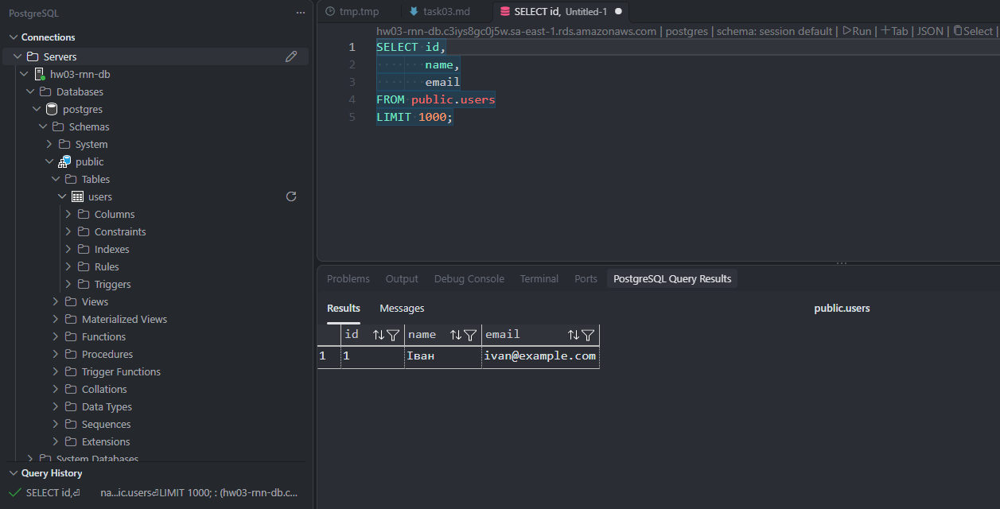

Додатково налаштовано підключення до тієї самої RDS-бази у VS Code. На кадрі видно дерево об’єктів `postgres → public → users` і результат запиту з тестовим записом; цей скриншот зроблено після створення та заповнення таблиці.

## 4. Створення таблиці users

У відкритому сеансі `psql` після запрошення `postgres=>` виконати запит і дочекатися відповіді **CREATE TABLE**:

```sql
CREATE TABLE users (
    id SERIAL PRIMARY KEY,
    name VARCHAR(100),
    email VARCHAR(100) UNIQUE
);
```

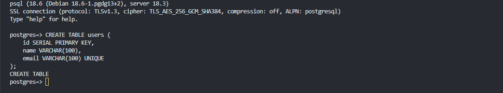

Створено таблицю `users` з автоматичним числовим ідентифікатором, ім’ям та унікальною електронною адресою. Відповідь **CREATE TABLE** підтверджує успішне виконання запиту.

## 5. Додавання тестового запису

У тому самому сеансі `psql` виконати вставлення одного рядка. Після запиту має з’явитися відповідь **INSERT 0 1**:

```sql
INSERT INTO users (name, email)
VALUES ('Іван', 'ivan@example.com');
```

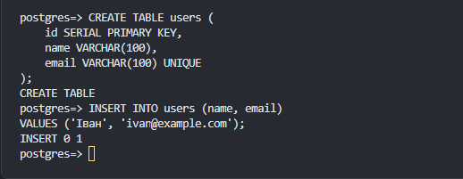

Додано запис з ім’ям **Іван** та адресою **ivan@example.com**. Відповідь **INSERT 0 1** підтверджує вставлення одного рядка до створеної таблиці.

## 6. Перевірка збережених даних

У `psql` виконати запит і перевірити, що повернуто один рядок з ім’ям **Іван** та адресою **ivan@example.com**:

```sql
SELECT * FROM users;
```

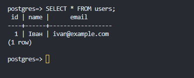

Виконано вибірку всіх рядків таблиці `users`. Отримано один запис: **1 | Іван | ivan@example.com**, що підтверджує збереження даних у RDS.

Для повторної перевірки у VS Code вибрати підключення **hw03-rnn-db**, відкрити SQL-редактор для бази **postgres** і виконати через **Run**:

```sql
SELECT * FROM public.users usr;
```

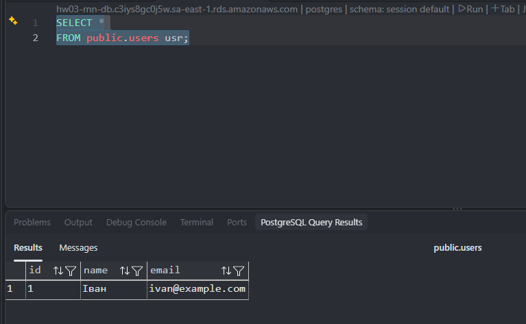

Повторно виконано вибірку `SELECT * FROM public.users usr` через розширення VS Code. У таблиці результатів отримано той самий запис — дані доступні й через інший клієнт.

У панелі Connections розгорнути **hw03-rnn-db → Databases → postgres → Schemas → public → Tables → users**. Залишити відкритими текст запиту та **PostgreSQL Query Results**, щоб на одному кадрі було видно підключення, таблицю й дані.

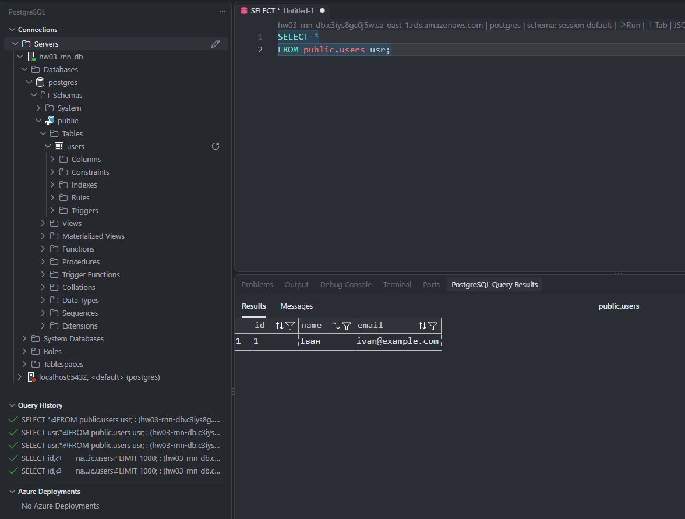

На загальному вигляді VS Code видно підключення `hw03-rnn-db`, таблицю `public.users` і результат SQL-запиту. Це додатково пов’язує отриманий запис із потрібною віддаленою базою.
