# Домашнє завдання 4: Зберігання та кешування даних в AWS

Створено S3-бакет `hw04-rnn-bkt` у регіоні **us-east-1 (N. Virginia)** та завантажено файл `hello.txt`. Налаштовано CloudFront-дистрибуцію `hw04-rnn-cf` з політикою **CachingOptimized**, перенаправленням HTTP на HTTPS і дозволеними методами **GET, HEAD**. Перевірено отримання файла через домен CloudFront. Після виконання завдання бакет і дистрибуцію видалено; результати збережено на скриншотах.

Шлях доступу: браузер → CloudFront → S3-бакет → `hello.txt`. Для CloudFront дозволено доступ до джерела S3 через політику бакета.

## 1. Створення S3-бакета

Порядок виконання:

1. Увійти в AWS Console та відкрити **Amazon S3 → Buckets → Create bucket**.
2. Вибрати **General purpose**, регіон **us-east-1** та вказати унікальне ім’я **hw04-rnn-bkt**.
3. Залишити **Object Ownership: ACLs disabled**.
4. Вимкнути **Block all public access**, як передбачено умовою завдання, та підтвердити попередження.
5. Інші параметри залишити за замовчуванням і натиснути **Create bucket**.

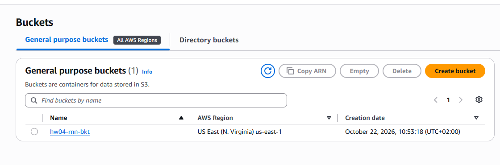

У списку Buckets видно бакет `hw04-rnn-bkt`, регіон **US East (N. Virginia), us-east-1** і дату створення.

## 2. Налаштування доступу до S3

Відкрити **S3 → hw04-rnn-bkt → Permissions** та перевірити блок **Block public access (bucket settings)**.

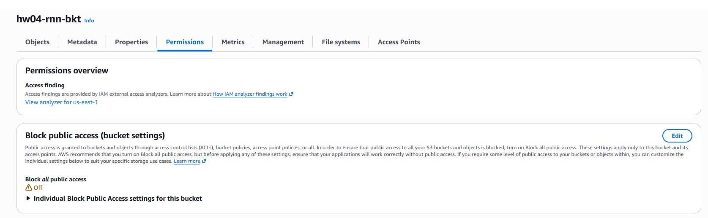

На скриншоті видно ім’я бакета та значення **Block all public access: Off**, що відповідає критерію завдання. Вимкнення блокування саме по собі не надає анонімним користувачам права читання об’єктів. Під час створення CloudFront вибрано дозвіл доступу до S3 для дистрибуції; відповідний параметр показано в розділі 4.

## 3. Завантаження файла в S3

Створити локальний файл `hello.txt` із текстом:

```text
Hello from S3 and CloudFront! HW04.
```

Відкрити **S3 → hw04-rnn-bkt → Objects → Upload → Add files**, вибрати `hello.txt` і натиснути **Upload**. Дочекатися успішного завершення завантаження.

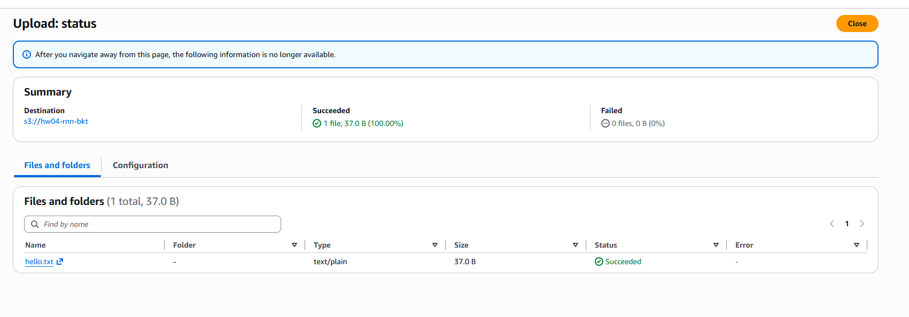

У Summary зазначено **Succeeded: 1 file, 37.0 B (100.00%)**, **Failed: 0 files**. Для `hello.txt` відображено тип **text/plain** та статус **Succeeded**.

Повернутися до бакета та перевірити список на вкладці **Objects**.

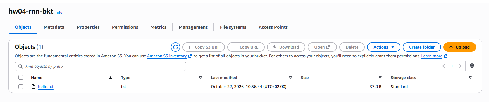

У корені бакета збережено один об’єкт `hello.txt` розміром **37.0 B**, клас зберігання — **Standard**. Скриншот підтверджує наявність файла у потрібному бакеті.

## 4. Створення CloudFront-дистрибуції

Порядок виконання:

1. Відкрити **CloudFront → Distributions → Create distribution**.
2. На кроці **Get started** вказати **Distribution name: hw04-rnn-cf**, опис **HW04 - S3 content delivery** і вибрати **Single website configuration**. Власний домен не вказувати.
3. На кроці **Specify origin** вибрати **Amazon S3 → Browse S3 → hw04-rnn-bkt**. Поле **Origin path** залишити порожнім, оскільки файл лежить у корені бакета.
4. Залишити ввімкненим **Allow private S3 bucket access to CloudFront** і рекомендовані налаштування джерела. Цей вибір дозволяє CloudFront налаштувати політику бакета для доступу дистрибуції до S3.
5. У **Customize cache settings** вибрати **Viewer protocol policy: Redirect HTTP to HTTPS**, **Allowed HTTP methods: GET, HEAD**, **Cache policy: CachingOptimized**. Origin request policy та Response headers policy залишити порожніми.
6. На кроці **Enable security** вибрати **Do not enable security protections**: AWS WAF не потрібний за умовою цього завдання.
7. На сторінці **Review and create** перевірити параметри, натиснути **Create distribution** та дочекатися завершення розгортання.

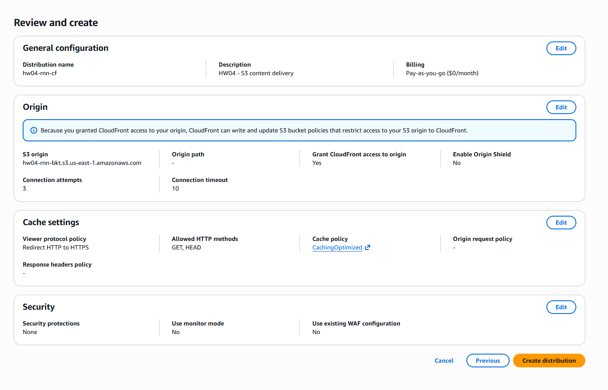

На підсумковій сторінці видно ім’я `hw04-rnn-cf`, джерело `hw04-rnn-bkt.s3.us-east-1.amazonaws.com`, **Grant CloudFront access to origin: Yes**, політику **CachingOptimized** і методи **GET, HEAD**. Origin Shield та WAF не ввімкнено.

Створена дистрибуція має ID `ERZ50GQSDGUWH` і домен `d2m2vcayconxlk.cloudfront.net`. Дистрибуцію з її доменом видно на скриншоті вкладки Behaviors у розділі 6, а в загальному списку Distributions — на скриншоті вимкнення в розділі 7.

## 5. Перевірка доступності контенту через CloudFront

Після завершення розгортання відкрити домен дистрибуції у браузері. Запит до кореня домену без шляху до файла повернув **AccessDenied**.

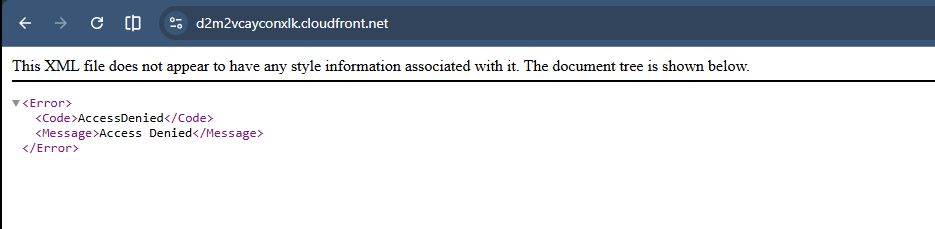

Для дистрибуції не задано **Default root object**. Тому перевірку отримання завантаженого об’єкта виконано за повним шляхом `/hello.txt`; відповідь на запит до кореня не є результатом перевірки цього файла.

Відкрити у браузері:

```text
https://d2m2vcayconxlk.cloudfront.net/hello.txt
```

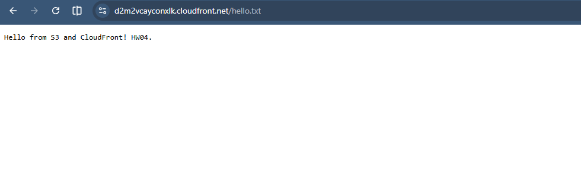

В адресному рядку видно домен CloudFront і шлях `/hello.txt`, а на сторінці — текст **Hello from S3 and CloudFront! HW04.** Це підтверджує доступність об’єкта S3 через CloudFront. Адресу наведено для фіксації результату; після видалення ресурсів вона більше не призначена для перевірки.

## 6. Перевірка політики кешування та доступу

Відкрити **CloudFront → Distributions → hw04-rnn-cf → Behaviors**, вибрати поведінку **Default (*)** і переглянути її деталі.

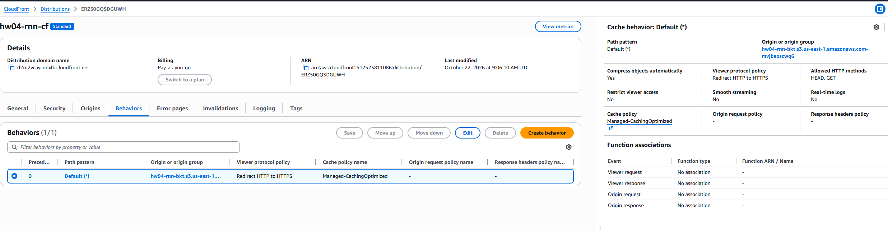

На скриншоті видно створену дистрибуцію `hw04-rnn-cf`, її ID і **Distribution domain name**. Для поведінки **Default (*)** перевірено:

- **Origin:** S3-бакет `hw04-rnn-bkt`.
- **Viewer protocol policy:** Redirect HTTP to HTTPS.
- **Allowed HTTP methods:** HEAD, GET.
- **Cache policy:** Managed-CachingOptimized — керована політика CachingOptimized.
- **Compress objects automatically:** Yes.
- **Restrict viewer access:** No.

Параметри відповідають вимогам завдання щодо політики кешування та дозволених HTTP-методів. Origin request policy, Response headers policy та функції для запитів і відповідей не налаштовувалися.

## 7. Видалення ресурсів

### CloudFront

1. Відкрити **CloudFront → Distributions**, вибрати дистрибуцію `ERZ50GQSDGUWH` та натиснути **Disable**.
2. Підтвердити вимкнення. Статус змінюється на **Disabled**, а в полі **Last modified** тимчасово відображається **Deploying**.

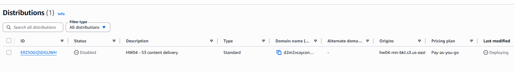

Цей кадр підтверджує вимкнення дистрибуції, але ще не її видалення.

3. Дочекатися, доки замість **Deploying** з’явиться дата й час завершення зміни.
4. Вибрати дистрибуцію, натиснути **Delete** та підтвердити видалення.
5. Оновити список Distributions і перевірити відсутність дистрибуції.

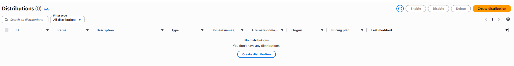

На скриншоті зазначено **Distributions (0)** та **No distributions**, що підтверджує завершення видалення.

### S3

1. Відкрити **S3 → Buckets**, вибрати `hw04-rnn-bkt` та натиснути **Empty**.
2. Підтвердити очищення відповідно до підказки консолі й дочекатися завершення.
3. Повернутися до списку Buckets, вибрати бакет і натиснути **Delete**.
4. Ввести ім’я бакета для підтвердження та завершити видалення.

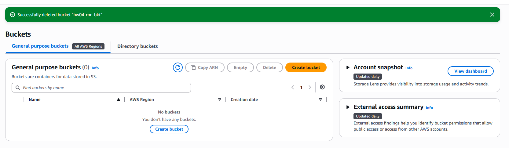

Повідомлення **Successfully deleted bucket "hw04-rnn-bkt"** і порожній список **General purpose buckets (0)** підтверджують видалення бакета. Скриншоти `05-1.png` та `05-2.png` фіксують завершення очищення обох основних ресурсів завдання.
