# Домашнє завдання 5: Тема 8. Моніторинг та аналітика в AWS

Налаштовано моніторинг EC2-інстансу `hw05-rnn-monitoring` у регіоні **us-east-1 (N. Virginia)**. Для CPU використано метрику **CPUUtilization**, для оперативної пам’яті — **mem_used_percent**, яку передає CloudWatch Agent. Створено два аларми: CPU > 80% та пам’ять > 75% протягом п’яти хвилин. Перевірено спрацювання CPU-аларму під навантаженням і доставку email через SNS. Після перевірки аларми та SNS-топік видалено; результати збережено на скриншотах.

Шлях сповіщення: EC2 → метрики CloudWatch → CloudWatch Alarm → SNS-топік `hw05-alerts` → email.

## 1. Налаштування моніторингу EC2

Порядок виконання:

1. У **EC2 → Instances → Launch instances** створити інстанс `hw05-rnn-monitoring` з **Amazon Linux 2023** і типом **t3.micro** у регіоні **us-east-1**.
2. Увімкнути публічну IPv4-адресу та дозволити SSH у Security Group. Для підключення з комп’ютера використати джерело **My IP**, а для браузерного **EC2 Instance Connect** — керований список префіксів `com.amazonaws.us-east-1.ec2-instance-connect` на TCP-порту **22**.
3. Через **Actions → Monitor and troubleshoot → Manage detailed monitoring** увімкнути detailed monitoring для отримання хвилинних метрик CPU.
4. У **IAM → Roles → Create role** створити роль `hw05-cloudwatch-role` для сервісу **EC2** з політикою **CloudWatchAgentServerPolicy**.
5. Прикріпити роль через **EC2 → інстанс → Actions → Security → Modify IAM role**.
6. Дочекатися завершення перевірок інстансу та підключитися через **Connect → EC2 Instance Connect** з користувачем `ec2-user`.

Ідентифікатор інстансу: `i-0e9fa8f81962c56fe`. Стандартна метрика CPU доступна у просторі імен **AWS/EC2**, а для збору пам’яті потрібно налаштувати агент на інстансі.

У терміналі EC2 встановити CloudWatch Agent:

```bash
sudo dnf install -y amazon-cloudwatch-agent
```

Створити конфігурацію для збору відсотка використаної оперативної пам’яті раз на 60 секунд:

```bash
sudo tee /opt/aws/amazon-cloudwatch-agent/etc/amazon-cloudwatch-agent.json > /dev/null <<'EOF'
{
  "agent": {
    "metrics_collection_interval": 60
  },
  "metrics": {
    "namespace": "CWAgent",
    "append_dimensions": {
      "InstanceId": "${aws:InstanceId}"
    },
    "metrics_collected": {
      "mem": {
        "measurement": ["used_percent"]
      }
    }
  }
}
EOF
```

Застосувати конфігурацію та запустити агент:

```bash
sudo /opt/aws/amazon-cloudwatch-agent/bin/amazon-cloudwatch-agent-ctl \
  -a fetch-config \
  -m ec2 \
  -c file:/opt/aws/amazon-cloudwatch-agent/etc/amazon-cloudwatch-agent.json \
  -s
```

Перевірити стан:

```bash
sudo /opt/aws/amazon-cloudwatch-agent/bin/amazon-cloudwatch-agent-ctl -a status
```

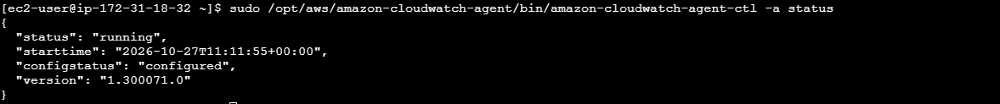

У відповіді видно **status: running** та **configstatus: configured**, що підтверджує запуск агента з конфігурацією.

Відкрити **CloudWatch → Metrics → Classic metrics → EC2 → Per-Instance Metrics**, вибрати свій `InstanceId` та метрику **CPUUtilization**.

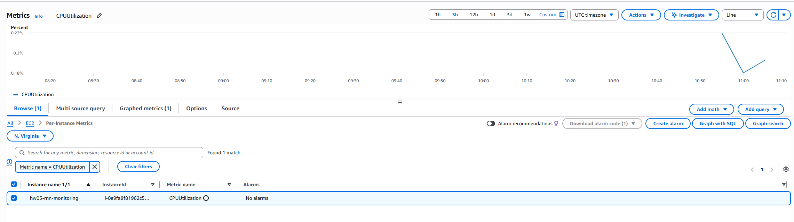

На скриншоті видно вибраний інстанс і дані завантаження CPU. Потім повернутися до **All**, відкрити **CWAgent → InstanceId** та додати **mem_used_percent** того самого інстансу. На вкладці **Graphed metrics** для обох метрик встановити **Statistic: Average**, **Period: 1 minute**.

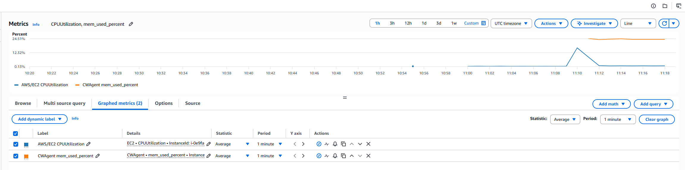

Обидві метрики надходять до CloudWatch. Метрика пам’яті, названа в умові **MemoryUtilization**, у використаній конфігурації агента має назву **mem_used_percent** у просторі імен **CWAgent**.

## 2. Створення CloudWatch Alarms

Порядок виконання:

1. На вкладці **Graphed metrics** натиснути значок створення аларму в рядку **CPUUtilization** свого інстансу.
2. Вибрати **Statistic: Average**, **Period: 1 minute**, **Threshold type: Static**, умову **Greater** та поріг **80**.
3. У **Additional configuration** встановити **Datapoints to alarm: 5 out of 5**, **Missing data treatment: Treat missing data as missing**. Залишити стандартне вікно оцінювання **Default (Sliding window)**.
4. На кроці **Configure actions** вибрати **In alarm** і SNS-топік `hw05-alerts`, налаштування якого описано в розділі 3.
5. Задати ім’я `hw05-cpu-high`, перевірити параметри та натиснути **Create alarm**.
6. Повторити створення для **CWAgent → mem_used_percent**: поріг **Greater than 75**, інші параметри ті самі. Ім’я другого аларму — `hw05-memory-high`, SNS-топік — `hw05-alerts`.

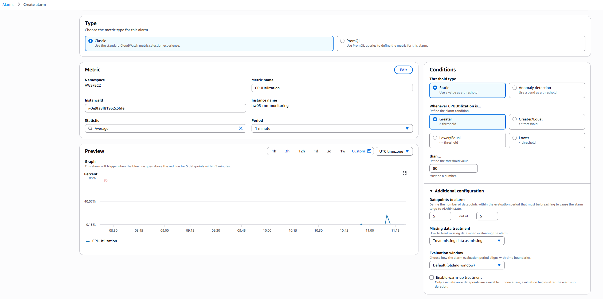

Період **1 minute** та **5 out of 5** означають, що п’ять послідовних хвилинних середніх значень мають перевищувати поріг. Для CPU встановлено **> 80%**, для пам’яті — **> 75%**.

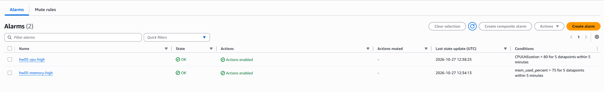

У списку видно `hw05-cpu-high` і `hw05-memory-high`, стан **OK**, **Actions enabled** та умови спрацювання обох алармів: п’ять вимірювань за п’ять хвилин. Цей скриншот підтверджує завершення створення обох алармів.

## 3. Налаштування SNS-сповіщень

Порядок виконання:

1. Під час налаштування повідомлень CPU-аларму вибрати **Create new topic**, вказати ім’я `hw05-alerts` та свою email-адресу.
2. Створити топік і відкрити лист **AWS Notification — Subscription Confirmation**.
3. Натиснути **Confirm subscription** у листі.
4. Відкрити **Amazon SNS → Topics → hw05-alerts → Subscriptions** та перевірити статус підписки.
5. Для обох алармів використовувати цей топік як дію під час переходу в **In alarm**.

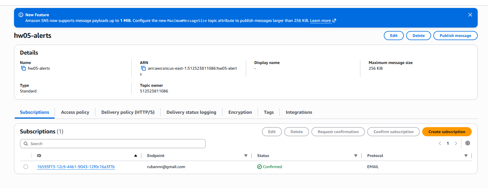

На скриншоті видно топік типу **Standard**, email у полі **Endpoint**, протокол **EMAIL** та статус **Confirmed**. Обидва аларми використовують одну підтверджену підписку через спільний топік.

## 4. Перевірка спрацювання аларму

У терміналі EC2 запустити по одному процесу навантаження на кожен логічний CPU на вісім хвилин:

```bash
for ((i=0; i<$(nproc); i++)); do
  timeout 480s yes > /dev/null &
done
wait
```

Це розширений варіант команди `yes > /dev/null &`, наведеної в умові завдання. Як працює команда:

- `nproc` повертає кількість доступних логічних CPU, а `$(nproc)` підставляє це число в умову циклу.
- `for ((i=0; i<$(nproc); i++))` запускає по одному процесу навантаження на кожен доступний логічний CPU. Процеси не закріплюються за окремими CPU — їх розподіляє планувальник ОС.
- `yes` безперервно генерує рядки тексту, створюючи навантаження на процесор.
- `> /dev/null` відкидає цей вивід, щоб не заповнювати термінал або файл.
- `timeout 480s` обмежує роботу кожного процесу вісьмома хвилинами, після чого завершує його.
- `&` запускає кожен процес у фоні, тому всі процеси навантаження працюють одночасно.
- `wait` очікує завершення всіх фонових процесів, запущених у цьому сеансі оболонки.

На інстансі з двома доступними логічними CPU цикл запускає два процеси `yes`, що дозволяє навантажити обидва CPU. На відміну від прикладу `stress --cpu 2 --timeout 300`, тривалість збільшено з п’яти до восьми хвилин: це дає запас для отримання п’яти повних хвилинних вимірювань вище порогу та надходження даних до CloudWatch. Після завершення таймерів навантаження припиняється автоматично.

Відкрити **CloudWatch → Alarms → hw05-cpu-high**, оновлювати дані та дочекатися переходу в **In alarm**.

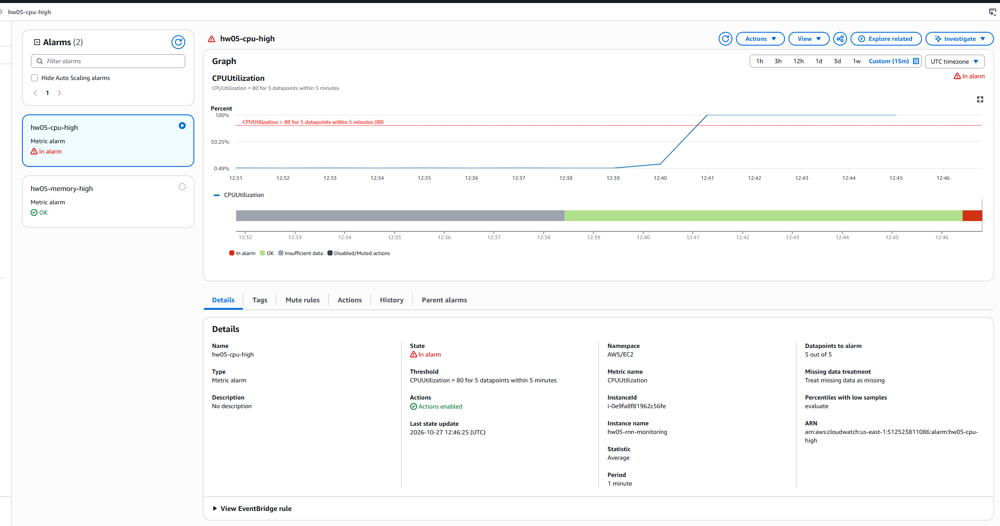

На графіку CPU досягає приблизно **100%**, перевищуючи поріг **80%**. Видно стан **In alarm**, період **1 minute** та **Datapoints to alarm: 5 out of 5**.


CPU-аларм перейшов у **In alarm**, а аларм пам’яті залишився в **OK**. CPU-тест перевіряє навантаження процесора та доставку сповіщення; перевищення порогу оперативної пам’яті цим тестом не створювалося.

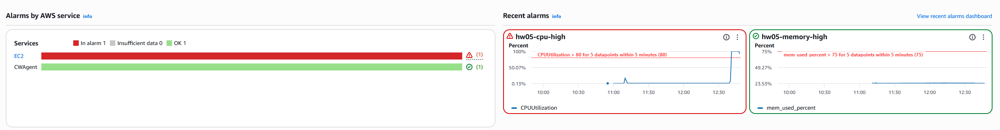

В огляді видно один аларм у стані **In alarm** для EC2 та один у стані **OK** для CWAgent. Графік пам’яті залишається нижче встановленого порогу **75%**.

## 5. Отримання email-сповіщення

Після спрацювання CPU-аларму відкрити поштову скриньку, підписану на SNS-топік `hw05-alerts`, і знайти лист із темою **ALARM: "hw05-cpu-high" in US East (N. Virginia)**.

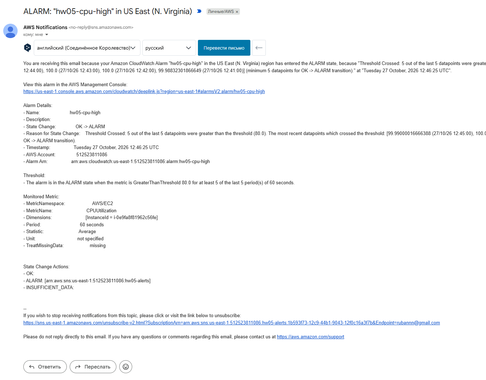

У листі видно перехід **OK → ALARM**, причину **Threshold Crossed** та перевищення порогу **80.0** у п’яти з останніх п’яти вимірювань. Також зазначено метрику **CPUUtilization**, статистику **Average**, період **60 seconds**, ідентифікатор інстансу та SNS-топік `hw05-alerts` у діях аларму. Час переходу — **27 жовтня 2026 року, 12:46:25 UTC**. Отриманий лист підтверджує роботу всього шляху сповіщення.

## 6. Графік навантаження CPU

Відкрити **CloudWatch → Metrics → Classic metrics → EC2 → Per-Instance Metrics**, вибрати **CPUUtilization** свого інстансу та встановити **Average**, **1 minute**. Вибрати часовий діапазон, який охоплює початок і завершення тесту.

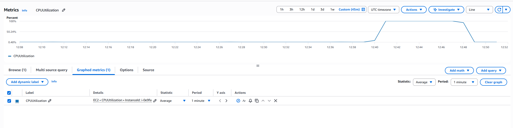

На графіку видно низьке початкове завантаження, підйом приблизно до **100%** близько **12:41 UTC** та повернення до низьких значень близько **12:49 UTC**. Тривалість підвищеного навантаження відповідає восьмихвилинному тесту. У таблиці під графіком видно метрику, статистику **Average** та період **1 minute**.

## 7. Видалення ресурсів моніторингу

### CloudWatch Alarms

1. Відкрити **CloudWatch → Alarms**, вибрати `hw05-cpu-high` та `hw05-memory-high`.
2. Натиснути **Actions → Delete**, підтвердити видалення та оновити список.

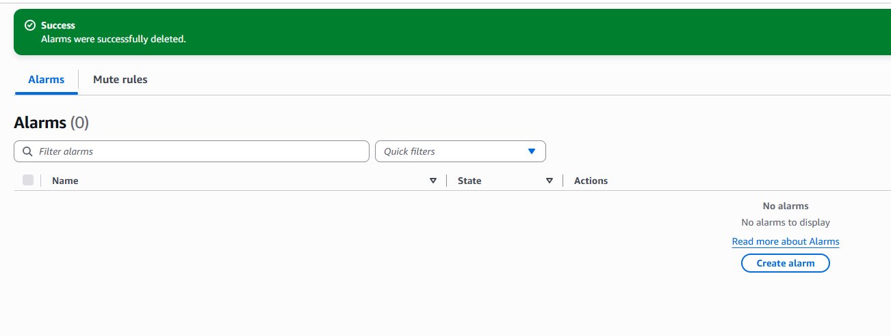

Повідомлення **Alarms were successfully deleted**, значення **Alarms (0)** та напис **No alarms** підтверджують видалення алармів.

### Amazon SNS

1. Відкрити **Amazon SNS → Topics**, вибрати `hw05-alerts`.
2. Натиснути **Delete**, виконати підтвердження відповідно до підказки консолі та перевірити список топіків.

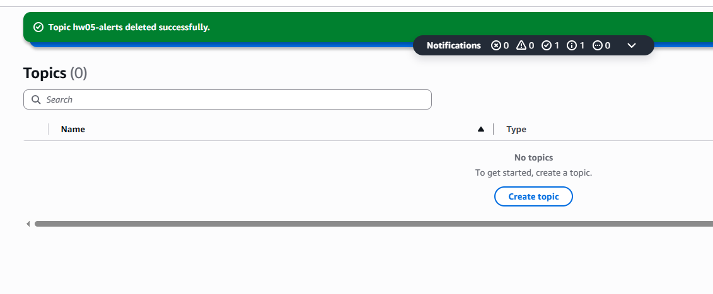

Повідомлення **Topic hw05-alerts deleted successfully**, значення **Topics (0)** та напис **No topics** підтверджують видалення топіка. Скриншоти фіксують очищення алармів і SNS-топіка; завершення роботи EC2 та вимкнення агента ними не підтверджуються.

