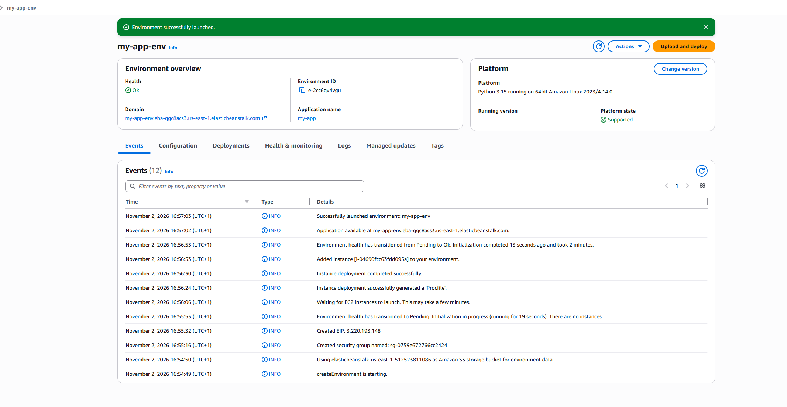
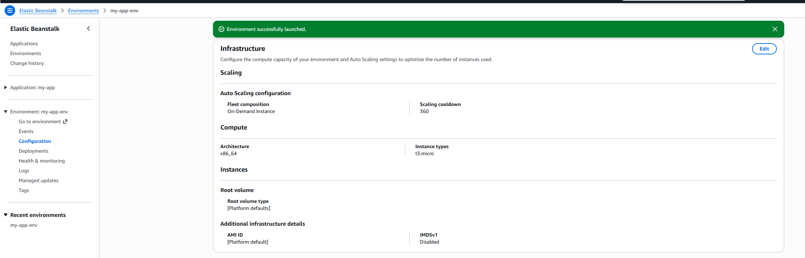
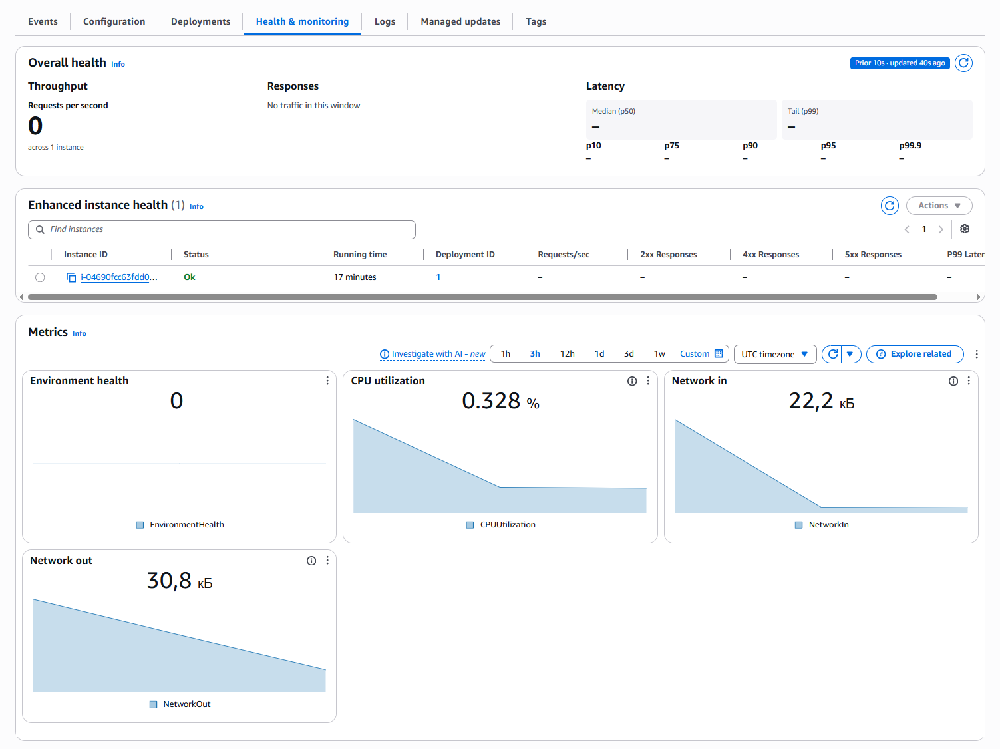
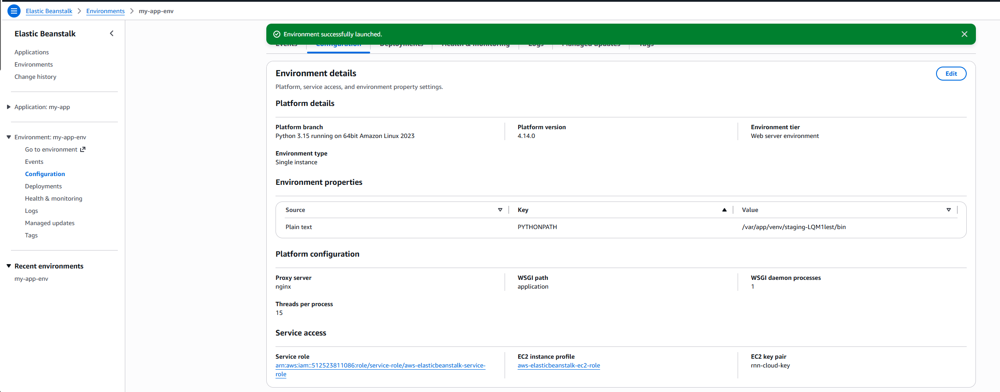
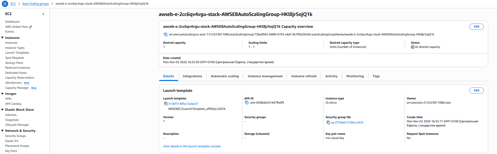
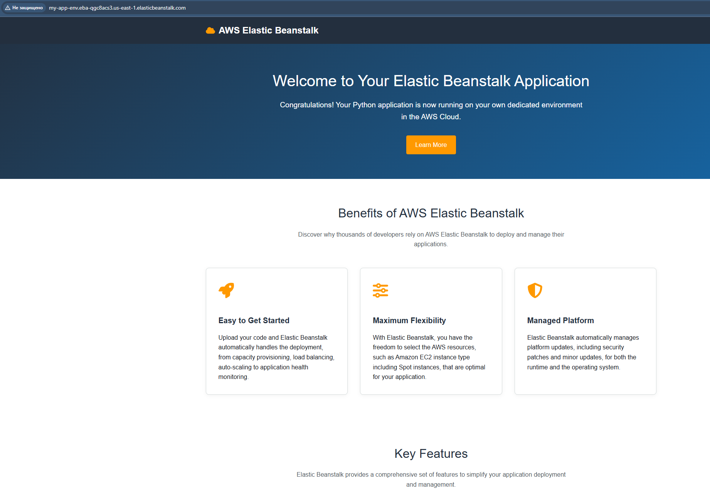

# Домашнє завдання 6: Тема 9. Розгортання та DevOps

Розгорнуто тестовий Python-застосунок в **AWS Elastic Beanstalk** у регіоні **us-east-1 (N. Virginia)**. Створено застосунок `my-app` та середовище `my-app-env` типу **Single instance** з EC2-інстансом **t3.micro**. Увімкнено **Enhanced health reporting**, перевірено метрики CPU, мережевого трафіку та стану середовища. Доступність застосунку підтверджено відкриттям тестової сторінки за згенерованим URL.

## 1. Створення застосунку та середовища в Elastic Beanstalk

Порядок виконання:

1. У регіоні **us-east-1** відкрити **Elastic Beanstalk → Applications → Create application**.
2. Задати **Application name: my-app** та створити застосунок.
3. Натиснути **Create new environment**, вибрати режим **Standard** та вказати **Environment name: my-app-env**.
4. Вибрати платформу **Python**, гілку **Python 3.15 running on 64bit Amazon Linux 2023** та рекомендовану на момент створення версію **4.14.0**.
5. У **Application code** вибрати **Sample app**, у **Environment tier** — **Web server environment**, у **Environment type** — **Single instance**.
6. Налаштувати доступ, інфраструктуру та моніторинг відповідно до наступних розділів, перевірити **Review** і натиснути **Create**.
7. Дочекатися повідомлення **Environment successfully launched** та стану **Health: Ok**.

На скриншоті видно назви застосунку та середовища, платформу Python, стан **Ok**, домен і події успішного розгортання. Повідомлення **Successfully launched environment: my-app-env** підтверджує завершення створення середовища.

## 2. Налаштування інфраструктури та доступу

Порядок виконання:

1. Під час створення середовища розкрити **Service access**.
2. Для **Service role** вибрати **Create default role** — консоль створює роль `aws-elasticbeanstalk-service-role`.
3. Для **EC2 instance profile** вибрати **Create default role** — консоль створює профіль із роллю `aws-elasticbeanstalk-ec2-role`.
4. У **EC2 key pair** залишити `rnn-cloud-key`.
5. У **Infrastructure → Compute** вибрати архітектуру **x86_64** та єдиний тип інстансу **t3.micro**. Для кореневого диска залишити **Platform default**.
6. У **Networking** залишити **Default VPC** та вибрані публічні підмережі. Поле додаткових **EC2 security groups** залишити порожнім; групу для середовища створює Elastic Beanstalk.
7. Після запуску відкрити **Configuration → Infrastructure** та перевірити тип інстансу.

**Примітка щодо повторного використання ресурсів:** пару ключів `rnn-cloud-key` взято з попередніх домашніх завдань; у ДЗ6 нову пару ключів не створювали. Використано наявну **Default VPC** та її публічні підмережі — окрему мережу для цього завдання не створювали.

Для обох IAM-ролей Elastic Beanstalk під час створення вибрано **Create default role**. Ролі `aws-elasticbeanstalk-service-role` та `aws-elasticbeanstalk-ec2-role` створено в межах ДЗ6. Групу безпеки середовища також створено Elastic Beanstalk у межах цього завдання; правила Security Group з попередніх ДЗ вручну не переносили.

На скриншоті видно **Instance types: t3.micro**, архітектуру **x86_64**, використання **On-Demand Instance** та стандартні параметри кореневого диска. Ролі доступу відображено на скриншоті в розділі 4.

## 3. Моніторинг і логування

Порядок виконання:

1. Під час створення середовища у **Monitoring and updates** вибрати **Monitoring: Enhanced** та **Monitoring interval: 5 minutes**.
2. Залишити **Instance log streaming to CloudWatch Logs** вимкненим. Потокове передавання логів не налаштовувалося.
3. Для розгортання залишити **Deployment policy: All at once**, автоматичні **Managed updates** вимкнути.
4. Після запуску відкрити **Health & monitoring** та дочекатися надходження метрик.
5. Перевірити **Environment health**, **CPU utilization**, **Network in** та **Network out**.

На скриншоті видно один інстанс зі статусом **Ok** і всі чотири потрібні метрики: **EnvironmentHealth**, **CPUUtilization**, **NetworkIn**, **NetworkOut**. На момент знімка завантаження CPU становить **0.328%**, вхідний трафік — **22,2 kB**, вихідний — **30,8 kB**. Графіки відображають історію надходження метрик після запуску середовища.

## 4. Конфігурація потужності середовища

Порядок виконання:

1. Відкрити **Configuration → Environment details**.
2. Перевірити **Environment type: Single instance** та **Environment tier: Web server environment**.
3. Під час створення в **Infrastructure → Scaling** перевірити зафіксовані значення **Min instances: 1** та **Max instances: 1**.
4. Для додаткового підтвердження відкрити **EC2 → Auto Scaling Groups**, вибрати групу цього середовища та перевірити **Desired capacity: 1**, **Scaling limits: 1–1**.

На скриншоті видно **Environment type: Single instance**, платформу Python та призначені **Service role** і **EC2 instance profile**.

На скриншоті видно **Desired capacity: 1**, **Scaling limits: 1–1** та статус **At desired capacity**. Це підтверджує **Min = 1**, **Max = 1** та **Desired capacity = 1**. У параметрах launch template також видно **Instance type: t3.micro**. Ідентифікатор середовища `e-2cc6qv4vgu` в назві групи збігається з **Environment ID** на скриншоті `01.png`.

У режимі **Single instance** середовище підтримує один EC2-інстанс: **Min = Max = Desired capacity = 1**. Балансувальник навантаження та тригери масштабування в цьому режимі не використовуються. Автоматичне масштабування зі змінними Min/Max потребує режиму **Load balanced**, який у цій роботі не застосовувався.

У використаному інтерфейсі AWS параметри, зазначені в умові як **Instance traffic and scaling**, розділено між **Environment details** та **Infrastructure**. Тому тип інстансу й тип середовища підтверджено двома скриншотами.

## 5. Перевірка доступу до застосунку

Порядок виконання:

1. На сторінці середовища знайти поле **Domain**.
2. Відкрити згенерований URL у браузері:

   `http://my-app-env.eba-qgc8acs3.us-east-1.elasticbeanstalk.com`

3. Переконатися, що завантажилася тестова сторінка Python-застосунку.

На скриншоті видно адресу середовища та сторінку **Welcome to Your Elastic Beanstalk Application** з повідомленням про запущений Python-застосунок. Застосунок доступний через **HTTP**; HTTPS у межах цієї роботи не налаштовувався.
